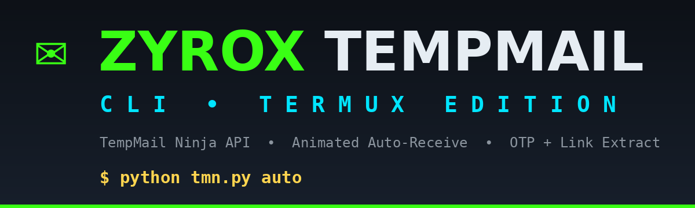
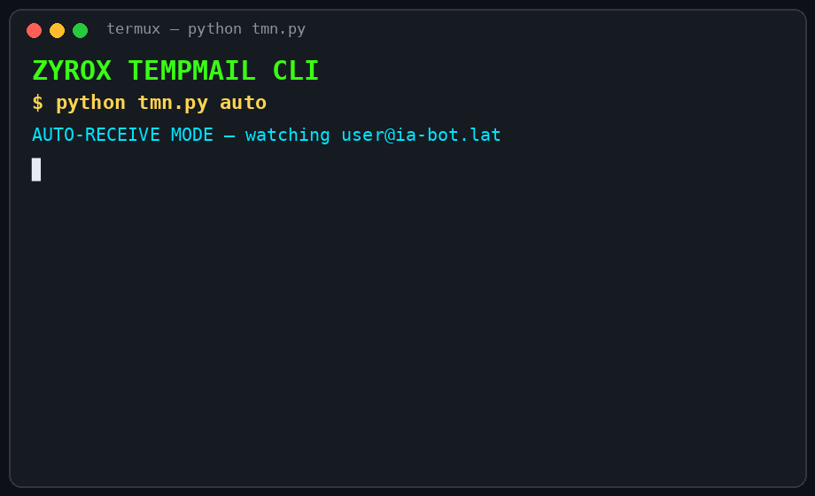

<p align="center">
  
</p>

<p align="center">
  
</p>

<p align="center">
  
  
  
  
</p>

<p align="center">
  
</p>

---

## ⚡ Features

- 📩 **Instant temp mail** — one tap, fresh `.lat` address (Quick Mail, 24h)
- 🥷 **Shadow Mail** — `.org` / `.com` domains, valid 30 days
- ✏️ **Custom Mail** — apna alias choose karo (`myname@domain`)
- 📡 **Animated Auto-Receive** — live spinner ke saath inbox watch; naya mail aate hi **beep + full card** screen pe
- 🔑 **OTP auto-extract** — mail kholte hi OTP alag se highlight
- 🔗 **Verification links auto-extract** — HTML button ke andar chhupe links bhi body me + alag `LINKS` section me dikhte hain (confirm/verify links ke liye perfect)
- 📥 **Live inbox** — sender, subject, time ke saath mail list
- 📧 **My Mails + Switch** — saare addresses ek jagah, kisi pe bhi wapas switch
- 💾 **Auto session save** — tool band karke kholo, wahi mail wapas (token-based restore)

---

## 🚀 Installation (Termux)

```bash
pkg update && pkg install python git -y
pip install requests
git clone https://github.com/zyroxteam/ZYROX-TEMPMAIL-CLI
cd ZYROX-TEMPMAIL-CLI
python tmn.py
```

Ya seedha quick install:

```bash
bash install.sh
```

---

## 📖 Usage

### Menu mode (sabse easy)

```bash
python tmn.py
```

Animated menu se option choose karo — New Mail, Custom, Shadow, Inbox, Read, Auto-Receive, My Mails.

### Command mode

| Command | Kaam |
|---|---|
| `python tmn.py new` | Naya Quick mail (`.lat`, 24h) |
| `python tmn.py custom` | Apne alias ka mail banao |
| `python tmn.py shadow` | Shadow mail (`.org` / `.com`, 30 din) |
| `python tmn.py inbox` | Inbox ki mail list |
| `python tmn.py read 1` | Mail #1 kholo (OTP + links ready) |
| `python tmn.py mails` | Mere saare addresses + active switch |
| `python tmn.py auto` | 📡 **Auto-Receive** — live watch mode |

---

## 📡 Auto-Receive Mode

```bash
python tmn.py auto
```

Tool tumhare active mail ko har **8 second** me check karta hai, animated spinner ke saath.
Jaise hi koi naya mail aata hai — **beep** ke saath pura mail card screen pe: sender, subject, **OTP** aur **verification link** ready-to-copy. `Ctrl+C` se band.

> Signup OTPs aur account-confirm links ke liye yahi mode best hai 😈

---

## 🧠 How It Works

- Backend **tempmail.ninja** ke Socket.IO API pe based hai (reverse-engineered, clean-room client — `tmn_client.py`)
- Har user ka apna guest session + JWT token; token `~/.zyrox_tmn.json` me save hota hai, isliye tool reopen karne pe wahi mailbox restore ho jata hai
- `get_email_messages` me `messageType: "inbound"` — yehi sahi bucket hai
- HTML mails me links `<a href>` ke andar hote hain — client strip karne se pehle unhe preserve karta hai, isliye verify links kabhi gayab nahi hote

---

## ⚠️ Notes

- Guest accounts pe max **25 mails**; `.lat` domains **24 ghante** me expire hote hain
- Kuch websites disposable domains block karti hain — wahan mail nahi aayega, ye un sites ki policy hai
- Mail create pe kabhi-kabhi server cooldown deta hai (`rate_limit`) — thodi der ruk ke dobara try karo

---

## 📜 Disclaimer

Ye tool sirf **educational & personal use** ke liye hai. Kisi bhi service ke terms ke khilaf istemaal ki zimmedari user ki khud ki hai.

---

<p align="center">
  <b>Made with 😈 by ZYROX</b><br/>
  <sub>KMJ TIPS • ZYROX MODS</sub>
</p>
